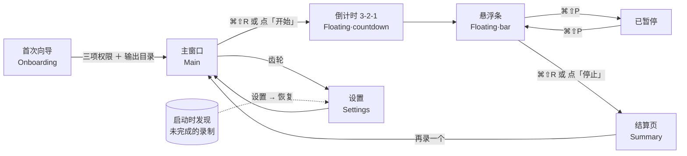

# UX · 用户旅程与体验清单

> 写于 2026-11-04 首版搭建期间。界面由 `ui` agent 实现，视觉由 `design` agent 定（`docs/DESIGN.md`、`design/tokens.css`）。
> 本页把需求逐条对到实现它的屏幕／组件；文件名按约定写，整合时若实际路径不同，以代码树为准并回来改这里。
> 「状态」列一律是「待验收」——真机行为只能靠实测（人工清单 `docs/MANUAL-CHECKLIST.md`）。

## 一、用户旅程



同一件事用文字画一遍：

```
首次向导 ──► 主窗口 ──► 倒计时 ──► 悬浮条 ◄──► 已暂停
 (只一次)      ▲            3·2·1       │
               │                        ▼
               └──── 再录一个 ◄──── 结算页
```

录制状态机（`Phase`，来自 `types.rs`）：

```
idle ──start──► countdown ──0──► starting ──ffmpeg 就绪──► recording ──pause──► paused
 ▲                 │ cancel                                   │  ▲        resume │
 │                 ▼                                          │  └───────────────┘
 └──────────────── idle ◄──── finalizing ◄────────── stop ────┘
                              (拼接 < 2 s)
```

## 二、屏幕与文件

| 屏幕／组件 | 文件（约定） | 干什么 |
|---|---|---|
| 首次向导 | `src/routes/Onboarding.svelte` | ffmpeg 检测 → 屏幕录制 → 摄像头 → 麦克风 → 输出目录；每步显示状态与「打开系统设置」按钮 |
| 主窗口 | `src/routes/Main.svelte` | 会议名、文件名预览、捕获目标、摄像头与 PiP、麦克风、系统声音、磁盘余量、开始按钮 |
| 舞台预览 | `src/lib/components/StagePreview.svelte` | 屏幕缩略图 ＋ 可拖动的摄像头小窗（`getUserMedia` 预览），四角吸附、大小、形状、镜像 |
| 电平表 | `src/lib/components/LevelMeter.svelte` | 麦克风实时电平（录制中也在跑，决定 D6） |
| 悬浮窗 | `src/routes/Floating.svelte` | 倒计时与录制条两种形态；常驻顶层、透明、无边框、可拖（决定 D11） |
| 结算页 | `src/routes/Summary.svelte` | 路径、时长、体积、与预算比、编码器、在 Finder 显示、压到预算、再录一个 |
| 设置 | `src/routes/Settings.svelte` | 语言、主题、输出目录、文件名模板、视频、音频、摄像头、快捷键、倒计时、低磁盘阈值、恢复列表 |
| 快捷键字段 | `src/lib/components/ShortcutField.svelte` | 按下组合键即录入；冲突与非法组合提示 |
| 提示条 | `src/lib/components/Toast.svelte` | 警告与错误（`warn.*`、`recorder://error`） |

## 三、需求清单（逐条对到实现）

| # | 需求 | 实现位置 | 状态 |
|---|---|---|---|
| 1 | 首次启动走向导，三项权限各自显示 已授权／已拒绝／未决定，拒绝时给「打开系统设置」 | `Onboarding.svelte` ← `check_permissions` `request_permission` `open_privacy_settings` | 待验收 |
| 2 | 向导检测 ffmpeg，显示路径、版本、是否内置 | `Onboarding.svelte` ← `get_app_info` | 待验收 |
| 3 | 会议名输入时实时预览文件名 `2026-11-04 1430 会议名.mp4`（决定 D10） | `Main.svelte` ← `preview_filename` | 待验收 |
| 4 | 选整屏或区域；「窗口」选项显示为禁用并注明「原生路径即将到来」（决定 D9） | `Main.svelte` → `CaptureTarget` | 待验收 |
| 5 | 摄像头小窗：四角、拖动偏移、大小 10–50 %、方／圆角／圆、镜像，预览即所得 | `StagePreview.svelte` → `CameraSettings` | 待验收 |
| 6 | 摄像头预览在录制开始时关掉（摄像头归 ffmpeg），麦克风电平继续（决定 D6） | `Main.svelte` `LevelMeter.svelte` | 待验收 |
| 7 | 显示磁盘剩余与「还能录 N 小时」；不足 10 分钟拒绝开始 | `Main.svelte` ← `check_disk` | 待验收 |
| 8 | 3-2-1 倒计时，可设秒数，0 ＝ 不倒计时；倒计时中可取消 | `Floating.svelte` ← `countdown://tick` `cancel_recording` | 待验收 |
| 9 | 录制时主窗口隐藏，悬浮条出现：REC 红点、时长、已写入／预计 MB、摄像头状态、麦克风电平、暂停／停止 | `Floating.svelte` ← `recorder://state` `recorder://progress` | 待验收 |
| 10 | 暂停／继续：悬浮条显示「已暂停」，时长停住，片段数 +1（决定 D4） | `Floating.svelte` ← `pause_recording` `resume_recording` | 待验收 |
| 11 | 全局快捷键 `⌘⇧R` `⌘⇧P` 在任何 app 前台都有效；可在设置里改 | `src-tauri/src/shortcuts.rs` → `shortcut://toggle` `shortcut://pause`；`ShortcutField.svelte` | 待验收 |
| 12 | 托盘：图标反映状态；菜单 开始／暂停／停止／显示主窗口／退出 | `src-tauri/src/tray.rs` | 待验收 |
| 13 | 停止后进结算页：路径、时长、体积、与预算比、编码器、音轨数 | `Summary.svelte` ← `recorder://finished` `RecordingResult` | 待验收 |
| 14 | 超预算时结算页提供「压到预算」，带进度与完成提示 | `Summary.svelte` ← `compress_to_budget` `compress://progress` | 待验收 |
| 15 | 「在 Finder／资源管理器中显示」 | `Summary.svelte` ← `reveal_in_file_manager` | 待验收 |
| 16 | 崩溃后重开，设置 → 恢复 列出未完成录制，可恢复或丢弃 | `Settings.svelte` ← `list_recoverable` `recover_session` `discard_session` | 待验收 |
| 17 | 警告以 Toast 出现：低磁盘、摄像头丢失、丢帧、超预算 | `Toast.svelte` ← `recorder://warning`（`warn.lowDisk` `warn.cameraLost` `warn.frameDrop` `warn.overBudget`） | 待验收 |
| 18 | 拔掉摄像头录制不中断，给提示 | `src-tauri/src/recorder.rs` ＋ `Toast.svelte` | 待验收 |
| 19 | 中英文自动跟随系统，可手动切；切换即时生效 | `src/lib/i18n/` ＋ `Settings.svelte` | 待验收 |
| 20 | 亮／暗跟随系统，可手动定；只用 `design/tokens.css` 的颜色（决定 D13） | 全部组件 | 待验收 |
| 21 | 键盘可达：所有控件 Tab 可到、焦点可见、Esc 关对话框、Space／Enter 激活 | 全部组件 | 待验收 |
| 22 | 设置以 JSON 持久化，旧版本文件不阻塞启动（决定 D12） | `src-tauri/src/commands.rs` ← `settings::from_json` | 待验收 |

## 四、快捷键

| 动作 | macOS | Windows | 范围 | 改哪里 |
|---|---|---|---|---|
| 开始／停止 | `⌘⇧R` | `Ctrl⇧R` | 全局（任何 app 前台） | 设置 → 快捷键（默认 `CmdOrCtrl+Shift+R`） |
| 暂停／继续 | `⌘⇧P` | `Ctrl⇧P` | 全局 | 设置 → 快捷键（默认 `CmdOrCtrl+Shift+P`） |
| 取消倒计时 | `Esc` | `Esc` | 悬浮窗有焦点时 | 不可改 |
| 关闭对话框 | `Esc` | `Esc` | 窗口内 | 不可改 |
| 激活按钮 | `Space` ／ `Enter` | 同 | 窗口内 | 不可改 |

全局快捷键与其他 app 冲突时，注册失败要在设置里显示红字并保留旧值，不能静默失效。

## 五、无障碍承诺

- 对比度按 `docs/DESIGN.md` 的令牌达到 WCAG AA；红色只给 REC，不单靠颜色传达状态（红点旁一定有文字「REC」）。
- 倒计时数字和警告用 `aria-live`（倒计时 `assertive`，警告 `polite`）。
- 悬浮条的按钮有可见焦点环，即便窗口透明。
- 尊重 `prefers-reduced-motion`：倒计时不做缩放动画，只换数字。
- 电平表给 `role="meter"` 与 `aria-valuenow`。
- 所有图标按钮带 `aria-label`，文案走 i18n。

## 六、i18n 规则

- 界面上的每一个字都来自 `src/lib/i18n/zh.ts` 与 `en.ts`，`.svelte` 里不写可见文字；两张表键一致（有测试查）。
- 警告代码（`warn.*`）与错误代码就是 i18n 键，Rust 侧只发代码和 `detail`，文案在前端。
- 中文用全角标点；英文句末无句号的按钮文案两边保持一致。
- 日期时间按系统区域显示，文件名里的日期固定 `YYYY-MM-DD HHmm`（决定 D10），不随语言变。
