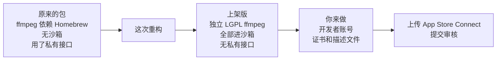

# 06 · Mac 上架版重构：沙箱、独立 ffmpeg、去掉私有接口

- 日期：2026-11-12。作者：Claude（Mac 负责人）。分支：`mac/app-store-sandbox`（基于 `mac/faceplate-fixes`），草稿 PR。
- 依据：Gabriel 2026-11-12 的指示“重构 MacBook 版本，要符合 Mac 上架要求；签名相关先绕过，后面统一做；按沙箱的标准来”。这改变了《04 · Mac App 上架计划》里“本阶段不做 App Store”的建议：现在直接按 App Store 的要求做。
- 证据都在 `tests/out/mas/`（已被 git 忽略）。级别：**A** 本机命令输出或截图；**D** 我的推断。核实日期都是 2026-11-12。

## 1. 结论

**上架版能打包、能在沙箱里启动、能录屏幕 ＋ 摄像头 ＋ 麦克风 ＋ 电脑声音、能暂停继续、能在窗口里回放。** 用的是本机测试签名，所以这个包只能在这台 Mac 上跑。真正上传还差 Apple 的证书和描述文件，这部分留给你。

原来的打包方式（`scripts/build-mac.sh`）没有改，照常能用。上架版是多出来的一条路：`scripts/build-mas.sh`。

## 2. 上架计划里的三个硬阻塞，现在的状态

| 阻塞（报告 04） | 现在 | 证据 |
|---|---|---|
| ffmpeg 动态链接 57 个 Homebrew 库 | **已解决**。新脚本从 ffmpeg.org 源码编译，只链接系统库 | A · `02-bundle-check.txt`“libraries outside the system”一节为空 |
| ffmpeg 是 GPL 构建 | **已解决**。新构建是 LGPL，没有外部库，也没有联网协议 | A · `ffmpeg -L` 输出“GNU Lesser General Public License” |
| 签名没有 Hardened Runtime，权限声明被丢掉 | **已解决**（本机测试签名）。主程序和四个辅助程序都是 `flags=0x10000(runtime)`，都带沙箱权限 | A · `02-bundle-check.txt` |

报告 04 里说的最大风险“打开 Hardened Runtime 之后摄像头、麦克风、屏幕录制还能不能用”，这次实测了：**能用。**

## 3. 实测结果

都是上架版在沙箱里跑出来的。

| 项 | 结果 | 证据 |
|---|---|---|
| 启动，进沙箱 | 通过。系统日志有 `AppSandbox`，容器目录已建立 | A · 系统日志、`~/Library/Containers/nz.co.flowgt.recorder` |
| 列出屏幕和缩略图 | 通过 | A · 截图 |
| 录屏幕 | 通过。HEVC 1920×1246，30 帧 | A · `03-sandbox-recording.txt` |
| 摄像头小窗 | 通过。内置摄像头的画面在右下角 | A · `04-frame-20s-corner.jpg` |
| 麦克风 | 通过。只开麦克风、扬声器放提示音时，峰值从 −38 dB 升到 −27 dB | A · `05-sandbox-recording-mic-only.txt` |
| 电脑声音 | 通过。峰值 −14.1 dB | A · `08-final-bundle-recording.txt` |
| 暂停再继续 | 通过，两段合成一个文件，22.8 秒 | A · `04-sandbox-recording-builtin-devices.txt` |
| 保存位置 | 通过。文件在 `~/Movies/FlowGT Recorder`，界面显示的也是这个路径，不是容器路径 | A · 截图、`ls` |
| 录完在窗口里回放 | 通过 | A · 截图 |
| 悬浮条（不透明 ＋ 原生圆角） | 通过 | A · 截图 |
| 屏幕蓝框（原生窗口） | 通过。四条边都是系统蓝 | A · 屏幕截图边缘像素 (59,134,247) |
| 沙箱拒绝记录 | 录制期间没有查到针对本应用的拒绝记录 | A · `06-sandbox-denials.txt` 为空 |
| 最终包再录一次 | 通过，18.0 秒 | A · `08-final-bundle-recording.txt` |
| 包里不含本机路径 | 通过。主程序和辅助程序里 `/Users/` 出现 0 次 | A · `02-bundle-check.txt` |

自动检查（`tests/out/mas/checks/`）：类型检查 0 错；前端测试 147 通过；Rust 测试 39 ＋ 124 通过（普通版和上架版各跑一遍）；clippy 两种构建都干净。`cargo fmt --check` 仍然不过，是 main 上原有的问题，这次没动。

## 4. 改了什么

| 改动 | 文件 | 说明 |
|---|---|---|
| 独立的 LGPL ffmpeg | `scripts/build-ffmpeg-mac.sh` | 从 ffmpeg.org 下载 7.1.1 源码，校验 SHA-256，编译约十分钟。脚本自己会拒绝 GPL 构建和非系统库 |
| 上架版打包脚本 | `scripts/build-mas.sh` | 检查 ffmpeg、打包、把辅助程序挪进 `Contents/Helpers`、放进许可证文件、逐个签名、最后核对每个可执行文件都进了沙箱 |
| 沙箱权限 | `src-tauri/entitlements/` | 主程序 8 项；辅助程序只有“沙箱 ＋ 继承” |
| 不用私有接口 | `src-tauri/src/windows.rs`、`tauri.mas.conf.json` | 透明窗口在 Mac 上靠 Tauri 的私有调用，上架版关掉：悬浮条改成不透明窗口加原生圆角，蓝框改成原生带边框窗口 |
| 保存路径 | `src-tauri/src/commands.rs` | 沙箱里“家目录”是容器，这里换回真正的 `~/Movies` |
| 自选保存文件夹 | `src-tauri/src/bookmark.rs` | 沙箱里自选文件夹的权限重启就没了，用系统的“安全书签”记住 |
| 包里不带本机路径 | `sidecar.rs`、`build-mas.sh` | 原来的包里有 670 处带用户名的路径，上架版清零，脚本会检查 |
| ffmpeg 许可证随包 | `build-mas.sh` | `Contents/Resources/licenses/` 里有声明（源码地址、哈希、编译参数）和 LGPL 全文 |
| 权限说明文字 | `src-tauri/Info.plist` | 原文写“Nothing is uploaded”，和 Google Drive 上传矛盾，改成“录到这台 Mac 上的文件” |

共享代码的改动都不影响 Windows：`mas` 这个开关默认关闭，路径换算只在路径里有 `/Library/Containers/` 时才起作用。

## 5. 没做到的和没验证的

| 项 | 状态 | 原因 |
|---|---|---|
| 上传 App Store Connect | 未做 | 没有 Apple 证书。脚本里用真证书的那一段从没跑过 |
| 系统弹框“…requesting to bypass the system private window picker…” | **出现了，我没点** | 这是 macOS 对直接录屏的应用弹的确认框。我们直接用 ScreenCaptureKit，没用系统自带的选择器。审核会不会因此卡住，**不知道** `[D]` |
| 自选保存文件夹的完整流程 | 未验证 | 书签代码有单元测试；“选文件夹 → 退出 → 重开 → 录制”要点系统的文件夹对话框，我没跑 |
| 权限提示里的“打开系统设置” | 未验证 | 沙箱里没点过 |
| 老用户的设置和 Google 登录 | 不会带过来 | 沙箱版用新的容器目录，从默认设置开始 |
| Google Drive 上传 | 未验证 | 本机没有 `.env.google`，登录功能没编进去 |
| “关于”页面显示 ffmpeg 许可证 | 未做 | 文件已随包，界面还没显示 |
| 蓝框上的“屏幕 N”标签 | 上架版没有 | 原生窗口只画了框 |
| Intel Mac | 不支持 | 只编了 Apple 芯片版 |
| 包大小 | 49 MB，其中 ffmpeg 和 ffprobe 约 40 MB | 没有裁剪 ffmpeg 的功能，裁了能小很多 |
| 暂停继续后时长 | 界面计时约 26 秒，文件 22.8 秒 | 没查原因。报告 03 里记过“继续”偶尔丢一段，可能是同一件事 |

## 6. 留给你的事

按顺序做，前三件是上传前必须的。

1. **注册 Apple Developer Program**（99 美元／年），决定用个人还是公司名义。
2. **在开发者后台建三样东西**：`Apple Distribution` 证书、`3rd Party Mac Developer Installer` 证书、Bundle ID `nz.co.flowgt.recorder` 的 Mac App Store 描述文件。
3. **用真证书打包**：设好 `MAS_APP_IDENTITY`、`MAS_TEAM_ID`、`MAS_PROVISIONING_PROFILE`、`MAS_INSTALLER_IDENTITY` 四个变量后运行 `bash scripts/build-mas.sh`，会多出一个 `.pkg`。
4. **点一下那个系统弹框**，然后看下次启动还弹不弹。
5. **试自选保存文件夹**：设置里选一个 `~/Movies` 以外的文件夹，退出，重开，录一段，看文件在不在。
6. **决定出口合规声明**：App Store Connect 会问应用是否使用加密。我们只用 HTTPS 连 Google，通常选“只用豁免的加密”。这是法律声明，我没替你填。
7. **删测试录像**：`~/Movies/FlowGT Recorder/` 里今天 13:33、13:34、13:36、13:48 四个文件是我录的。

## 7. 最没把握的三条

1. **审核能不能过**：我只对照了已知的硬要求（沙箱、无私有接口、无外部库、许可证）。直接录屏的系统弹框、`network.server` 权限的理由、把 ffmpeg 当辅助程序带进包，这三点审核员怎么看，只有提交了才知道。
2. **真证书签名后行为是否一样**：现在所有结果都来自本机测试签名。真证书会多出描述文件和团队标识两项，摄像头、麦克风权限理论上不受影响，但没跑过。
3. **麦克风“通过”的证据偏弱**：依据是放提示音时峰值升了 11 dB，不是听过录音。你回来后对着说一句话再听一遍最可靠。
