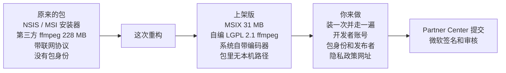

# 07 · Windows 上架版重构：MSIX 包、独立 ffmpeg、系统自带编码器

- 日期：2026-11-12。作者：Claude（Windows 负责人）。分支：`win/store-msix`，草稿 PR。
  这个分支把 `mac/app-store-sandbox`（#18）和之前所有 Windows 分支合在了一起，再加这次的改动。
- 依据：Gabriel 2026-11-12 的指示“重构 Windows 版本，尽量符合 Microsoft Store 上架标准，按打包应用（MSIX，有包身份）的能力来做；需要本人出面的先绕过”。
- 证据都在 `tests/out/store-win/`（已被 git 忽略）。微软文档的原文存在 `tests/out/store-win/sources/`，每页开头有网址和抓取日期。
- 级别：**A** 读到了官方原文或本机实测输出；**B** 官方页面但没逐字核对；**C** 第三方说法；**D** 我的推断。核实日期都是 2026-11-12。

## 1. 结论

**上架版的包能打出来（31 MB），清单通过了微软打包工具的校验；把包里的程序直接启动，屏幕＋摄像头＋麦克风能录、能暂停继续、能在窗口里回放。但这个包没有被安装过**：这台电脑不改系统设置就装不上，按你的规矩我停在了那里。所以“有包身份时”的行为（安装、首次启动、权限弹框、设置存哪、卸载）全部是**未验证**。

原来的打包方式（`npm run tauri build`）没有改，照常能编过。上架版是多出来的一条路：`scripts/build-ffmpeg-win.sh` ＋ `scripts/build-store-win.ps1`。

和 Mac 最大的不同：**Windows 上架不需要你自己的证书**。微软文档写的是 Store 分发的包“Signed by the Store on submission”（由商店在提交时签名）`[A]`。你要提供的是 Partner Center 给的包身份，不是证书。

## 2. 硬要求和硬阻塞，逐条

先说 Windows 上查出来的阻塞是什么。它们和 Mac 的三条不一样：这里的 ffmpeg 本来就不是 GPL，也没有外部库依赖。

| # | 阻塞 | 依据（原文） | 现在 | 证据 |
|---|---|---|---|---|
| 1 | 没有 MSIX 包，没有包身份。原来只出 NSIS／MSI 安装器，安装时还要联网下载 WebView2 引导程序 | 任务要求按打包应用来做；商店对安装器另有一套要求（10.2.9）`[A]` | **已解决（未安装验证）**。脚本产出 MSIX，`makeappx` 接受了清单 | A · `04-package-check.txt` |
| 2 | ffmpeg 是第三方预编译包：LGPL **第 3 版**，静态带了几十个第三方库，有 40 多种联网协议，两个文件各 114 MB，源码没有归档 | 你的要求（独立、LGPL、无联网、源码构建）；`docs/LICENSES.md` 里这一项一直挂着 | **已解决**。从 ffmpeg.org 源码编：LGPL 2.1、无外部库、无联网协议、各 30 MB | A · `audit/01`、`02`、`03` |
| 3 | 包里不能带本机路径和用户名 | 你的要求 | **已解决**。普通版主程序里有 711 处，上架版 0 处；脚本逐个文件检查 | A · `audit/04-app-binary-before-after.txt` |
| 4 | 启动系统小工具（`attrib.exe`、`explorer.exe`） | “Avoid starting command utilities such as PowerShell and Cmd.exe… all apps submitted to the Microsoft Store must be compatible with Windows 10 S” `[A]`（msix-prepare） | **已解决**。改成直接调系统接口 | A · 单元测试、`19-settings-link-and-hidden-folder.txt` |
| 5 | 完全信任（`runFullTrust`）是受限能力，要说明理由 | “a Medium IL app needs to declare the runFullTrust restricted capability”；受限能力“require approval for Microsoft Store submission” `[A]` | **清单已声明；理由要你在提交时填**（第 6 节有草稿） | A · `src-tauri/msix/AppxManifest.xml` |
| 6 | 必须有隐私政策网址 | 10.5.1：“Product types that inherently have access to Personal Information must always have privacy policies. These include, but are not limited to, Desktop Bridge and Win32 products.” `[A]` | **留给你**：要一个公开网址 | — |
| 7 | 版本号第一段不能是 0，第四段留给商店 | “The other sections must be set to an integer between 0 and 65535 (except for the first section, which cannot be 0)”；第四段“must be left as 0” `[A]` | **留给你决定**。现在是 0.1.0，脚本会提示；第四段已是 0 | A · 脚本输出 |
| 8 | 不能是调试构建 | “apps must not be compiled for debug” `[A]`（认证测试说明） | **已满足**：发布构建 | A · 构建日志 |
| 9 | 不能要求管理员权限、不能带驱动或服务 | “apps that require elevation for any part of their functionality won't be accepted”；“MSIX doesn't support Windows drivers” `[A]` | **本来就满足**：应用不提权，没有驱动和服务 | D · 读代码 |
| 10 | 要能干净卸载 | 10.2.7 `[A]`；系统卸载包时会删掉包目录和重定向的应用数据 `[A]` | **未验证**（没装过）。录像留在“视频”文件夹里不会被删，这是有意的 | — |

实测里另外撞出来的两个问题，不是商店要求，但不修上架版根本录不了：

| 问题 | 现象 | 修法 | 证据 |
|---|---|---|---|
| 系统自带的硬件编码器不收原来的像素格式 | 测试帧报 “Invalid argument”，应用悄悄降到软件编码 | 给 Media Foundation 编码器传 NV12 | A · 命令输出（本节下方）、单元测试 |
| 硬件编码器写出的分段文件打不开 | 录制、暂停、继续都正常，**停止时合并失败**，这段录像就丢了 | 这类编码器的文件头改成等第一段出来再写（`delay_moov`）；实测可读、可合并、中途杀掉进程也可读 | A · `audit/d-*.mp4` 的 ffprobe 结果 |

这两条对普通版也有效：普通版在没有独显、没有 Intel 核显驱动接口的电脑上也会走到这类编码器，以前同样会失败，只是这台机器上轮不到它。

审计的其余结论（`audit/01-ffmpeg-before.txt`）：

| 项 | 改之前 |
|---|---|
| 签名 | 什么都没签。普通安装器在别人电脑上会被 SmartScreen 拦 `[D]` |
| WebView2 | 不带，安装器联网下载引导程序。上架版不带也不下载，清单要求 Windows 11（文档：“The Evergreen WebView2 Runtime will be included as part of the Windows 11 operating system” `[A]`） |
| 屏幕 | ffmpeg 的 `ddagrab`（DXGI 桌面复制）。没有对应的能力声明，不是未公开接口 `[D]` |
| 摄像头、麦克风 | ffmpeg 的 DirectShow；自拍预览走 WebView2 |
| 电脑声音 | **录不了**，普通版和上架版都一样（ffmpeg 没有系统回放的输入） |
| 设置 | `%APPDATA%\nz.co.flowgt.recorder`；录像在“视频\FlowGT Recorder” |
| 主程序依赖的 DLL | 只有系统 DLL，没有 VC++ 运行库（普通版和上架版一样） |

## 3. 实测结果

“包里的程序”指 `src-tauri/target/store-win/layout/` 里那一批文件，就是 MSIX 里装的东西，但我是**直接启动**它们的，所以没有包身份。

| 项 | 结果 | 说明和证据 |
|---|---|---|
| 打包 | **通过** | 31,240,630 字节；清单通过 `makeappx` 校验 · `04-package-check.txt` |
| 安装 | **未验证** | 四种装法都被系统拒绝：未签名 `0x800B0100`；`-AllowUnsigned` 不许包里带可执行程序 `0x80073D2B`（Gabriel 2026-11-12 自己再试了一次，同样被拒：“an unsigned package cannot include Executable activations”，所以这条路对本应用走不通，脚本里的 `-Unsigned` 开关已删）；松散注册需要开发者模式 `0x80073CFF` · `05-install-attempts.txt` |
| 启动（无包身份） | **通过** | `10-main.png` |
| 列出屏幕 | **通过** | 1 块屏幕 3840×2160，1 个摄像头，3 个麦克风 |
| 选中的编码器 | **通过** | `hevc_mf`，硬件（Intel），用的是包里的 ffmpeg 9.0.2 |
| 录屏幕 | **通过** | HEVC Main，1920×1080，30 帧，每一帧都能解码 · `13-recording-A-ffprobe.txt` |
| 摄像头小窗 | **通过** | 右下角圆角方块里是摄像头画面 · `14-frame-20s-corner.jpg` |
| 麦克风 | **通过（证据弱）** | 有一条 AAC 音轨，48 kHz 双声道；房间是静的，峰值 −43.7 dB，平均 −78.8 dB。没人对着说话，我也没听 |
| 电脑声音 | **未通过** | Windows 上本来就没有这个功能，界面显示“不可用” |
| 暂停再继续 | **通过** | 两段合成一个文件，22.7 秒 · `12-recording-A.txt` |
| 体积 | **通过** | 872 kbps，预算 889 kbps（每小时 400 MB） |
| 录完回放 | **通过** | 窗口里的播放器 3 秒内从 0 走到 2.97 秒，1920×1080 · `16-playback.txt`、`15-summary.png` |
| 保存位置 | **通过** | 文件在“视频\FlowGT Recorder”，界面显示的也是这个真实路径 |
| 打开系统隐私设置 | **未验证** | 命令返回成功，也没有启动 `explorer.exe`；但设置页面有没有真的打开，我没拿到可靠证据 |
| 自编 ffmpeg 自查 | **通过** | LGPL 2.1；协议只剩 `file`、`pipe` 这类本地的；只依赖系统 DLL · `audit/03-ffmpeg-own-build-wine.txt`、`04-package-check.txt` |
| 软件 H.264（没有硬件编码器的电脑） | **部分** | 命令行实测能编、能读回；10 秒静止画面 735 kbps。没有在应用里走过这一档，也没测长时间录制 |
| 卸载后是否干净 | **未验证** | 没装过 |
| 有包身份时：权限弹框、设置落在哪、托盘、快捷键、悬浮条 | **未验证** | 没装过 |
| 微软的认证工具（WACK） | **未验证** | 它要先安装包 |

自动检查（`tests/out/store-win/checks/`）：类型检查 209 个文件 0 错；前端测试 147 通过；Rust 测试 40 ＋ 126 通过（普通版和上架版各跑一遍）；clippy 两种构建都干净；普通版发布构建编过。`cargo fmt --check` 不过，是 main 上原有的问题（改之前 252 处，现在 255 处，多的 3 处在本来就没按它排版的那个文件里）。

## 4. 改了什么

| 改动 | 文件 | 说明 |
|---|---|---|
| 独立的 LGPL ffmpeg | `scripts/build-ffmpeg-win.sh` | 从 ffmpeg.org 下 9.0.2 源码，校验 SHA-256（发布签名我手工验过一次：Good signature），交叉编译约十分钟。脚本自己拒绝：GPL 或 LGPL 3、有联网协议、缺少必需部件、依赖了系统以外的 DLL |
| 上架版打包脚本 | `scripts/build-store-win.ps1` | 检查 ffmpeg → 编应用 → 摆好包内容 → 生成各种尺寸的图标 → 填清单 → 逐个文件查本机路径 → 打成 MSIX。不签名 |
| 包清单 | `src-tauri/msix/AppxManifest.xml` | 只声明三项能力：完全信任（必需）、摄像头、麦克风，每项写了理由 |
| 编译开关 | `src-tauri/Cargo.toml`、`sidecar.rs` | 新增 `msix`，和 Mac 的 `mas` 并存；只影响“不去源码目录找 ffmpeg” |
| 包身份查询 | `commands.rs`、`lib.rs` | `package_identity()`，启动时写进日志。Mac 上恒为空 |
| 不启动系统小工具 | `recorder.rs`、`permissions.rs` | 隐藏文件夹和打开设置页都改成直接调系统接口 |
| 编码器 | `crates/core/src/encoders.rs`、`command.rs`、`commands.rs` | 上面两个修复，加一档软件 H.264。Mac 的编码器不受影响（有测试） |
| 不变量 | `CLAUDE.md` | 第 3 条补了一句：Media Foundation 编码器用 `delay_moov` |
| 文档 | `docs/WINDOWS-STORE.md`、`docs/LICENSES.md`、`scripts/README.md`、`src-tauri/binaries/README.md`、`00-START-HERE.md` | |

共享代码对 Mac 的影响：`msix` 默认关闭；编码器的两条规则只对名字以 `_mf` 结尾的编码器生效，Mac 上没有。没有改 `types.rs`，没有新增界面文字。

没有加任何联网调用，CSP 没动，`chrome-extension/` 没动。

## 5. 没做到的和没验证的

| 项 | 状态 | 原因 |
|---|---|---|
| 安装上架包，以及一切“有包身份时”的行为 | **未验证** | 这台电脑：不是管理员、开发者模式关着、没有受信任的证书。三条路都要改系统设置或点 UAC，按规矩没做 |
| 提交 Partner Center | 未做 | 没有账号 |
| WACK 认证测试 | 未做 | 要先安装 |
| 电脑声音 | 不支持 | 和普通版一样，要等原生采集引擎（`docs/tasks/W-6.md`） |
| Windows 10 | 上架版不支持 | 清单要求 Windows 11，因为 WebView2 在那里是系统自带的。这是我替你做的一个取舍，可以改 |
| ARM 电脑 | 不支持 | 只编了 x64 |
| 软件 H.264 那一档 | 只在命令行测过 | 这台机器有硬件编码器，应用里走不到那一档 |
| 设置里自选保存文件夹 | 未验证 | 要点系统的文件夹对话框；完全信任的应用不需要 Mac 那样的书签，按理直接可用 `[D]` |
| 老用户的设置 | 按文档会被读到 | 文档说包内应用先找自己的私有位置，找不到再读真实的 AppData `[A]`；没实测 |
| Google 登录和上传 | 未验证 | 本机没有 `.env.google`，登录没编进去 |
| 应用里显示许可证 | 未做 | 文件已随包，界面没显示 |
| 依赖库的许可证清单 | 未做 | `docs/LICENSES.md` 里原来就挂着的一项 |
| 长时间录制 | 未做 | 只录了 22 秒。HEVC 硬件编码走的是新的 ffmpeg 和新的分段方式，30 分钟以上没跑过 |

还有两件要你知道的事：

- **这台电脑开着“智能应用控制”（Smart App Control）**。我第一次编出来的 `ffmpeg.exe` 没签名，被它拦下不让运行；同一批的 `ffprobe.exe` 和最后一次编的两个文件却放行了。我没有去关它或绕它。这说明：**不走商店的普通安装器如果带着没签名的自编 ffmpeg，在开了这个功能的用户电脑上可能录不了**；商店签过名的包不受影响 `[D]`。
- 测试留下的东西：“视频\FlowGT Recorder”里有一个今天 17:53 的测试录像，隐藏文件夹 `.flowgt-recorder` 里有一个修复前失败的会话（两段打不开的分段）。为了编 ffmpeg，我在 WSL 的 Ubuntu 里装了 mingw-w64、gcc、make、nasm 和 wine（那里的 sudo 不要密码，没碰 Windows 的管理员权限）。我还误关了一次后台的“设置”进程，不影响任何设置。

## 6. 留给你的事

按顺序做。**1 到 6 是提交前必须的。**

1. **装一次，走一遍**（约 15 分钟）。先在系统设置里打开“开发人员模式”（这是你的决定，测完可以关回去），然后在普通 PowerShell 里：
   `Add-AppxPackage -Register src-tauri/target/store-win/layout/AppxManifest.xml`。
   （本报告最初写的是未签名安装 `-AllowUnsigned`，那条路走不通，见第 4 节“安装”一行。）
   从开始菜单启动，看：摄像头和麦克风有没有弹权限、能不能录、录完能不能放、设置改了重开还在不在、托盘和快捷键、悬浮条。最后卸载，看“视频”里的录像还在、其余的都没了。
2. **开 Partner Center 开发者账号**，决定个人还是公司。文档现在写的是两种都不收注册费 `[A]`；账号类型以后不能改 `[A]`。
3. **预留应用名**，在“产品身份”页抄三个值：包名、发布者（`CN=…`）、发布者显示名。
4. **把版本号改成 1.0.0 或更高**（`src-tauri/tauri.conf.json`），然后带上那三个值重新打包（命令在 `docs/WINDOWS-STORE.md`）。
5. **准备隐私政策网址**。内容可以从 `docs/PRIVACY.md` 来：录像只存在本机，登录 Google 后只传到用户自己的云端硬盘，没有遥测。
6. **提交时填的声明**：
   - 受限能力 `runFullTrust` 的理由。草稿：“A Win32 desktop screen recorder. It captures the display through DXGI Desktop Duplication, the camera and microphone through DirectShow, and encodes with ffmpeg.exe, a separate program inside the same package. None of this is available to an AppContainer app.”
   - 年龄分级问卷、类别、市场、价格（免费）。这些是你的声明，我没替你填。
7. **看一眼微软的认证工具**：装好包以后运行 Windows App Certification Kit，把报告留一份。
8. **决定要不要支持 Windows 10**。要的话清单得声明或自带 WebView2。
9. **决定普通安装器要不要签名**。走商店不用；商店之外分发，没签名的程序会被 SmartScreen 和智能应用控制拦。
10. **删测试文件**：“视频\FlowGT Recorder”里今天 17:53 的录像，和 `.flowgt-recorder` 里今天的那个会话文件夹。

## 7. 最没把握的三条

1. **装上以后会不会变样。** 所有“通过”都来自没有包身份的直接启动。有包身份后，摄像头和麦克风由系统的应用权限开关管，WebView2 的数据目录会被重定向，这些我只读了文档。验证办法：第 6 节第 1 条。
2. **系统自带编码器在别的电脑上的表现。** 只在这一台 Intel 核显上测过。NVIDIA、AMD 的硬件编码器接不接受同样的参数、文件头是不是同样晚给，不知道；没有硬件编码器时落到软件 H.264，体积会略超预算。验证办法：换一台不同显卡的电脑装上录一段，再用 `ffprobe` 看编码器和码率；在虚拟机里录一段看软件那一档。
3. **审核怎么看“包里带一个 ffmpeg.exe 并启动它”和完全信任的理由。** 政策条文我逐条对过，没有禁止；但受限能力是人工审的。验证办法：只有提交。可以先发邮件到文档里给的 `reportapp@microsoft.com` 问。
