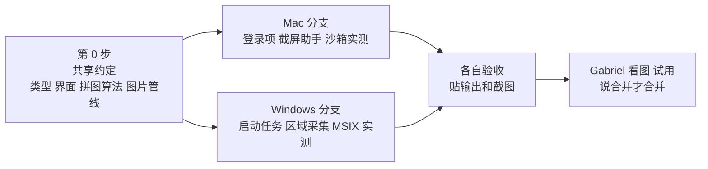
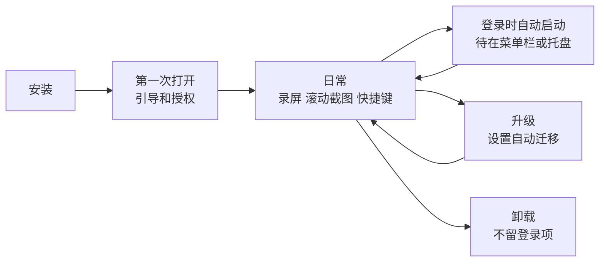
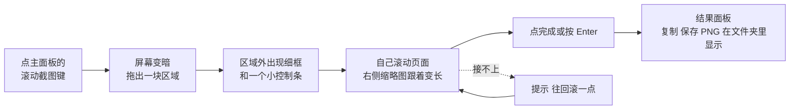
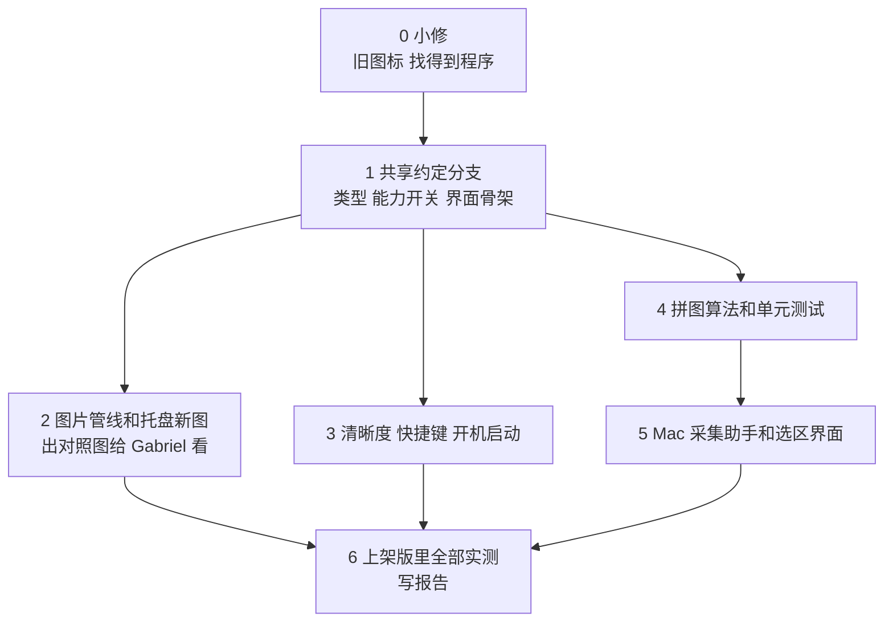

# 08 · 下一轮计划（Mac）：图片资产、4K、快捷键、开机启动、滚动截图

- 日期：2026-11-13。作者：Claude（Mac 负责人）。状态：**计划，等 Gabriel 点头再动手**。
- 依据：Gabriel 2026-11-13 的七条要求。配套的 Windows 计划是 `09-下一轮计划-Windows-2026-11-13.md`；第 2–5 节两份完全相同。
- 证据级别：**A** 读了代码、包或官方原文；**D** 我的推断，待验证。

## 1. 先回答三个问题

**程序在哪。** 打出来的包在仓库里的 `src-tauri/target/mas/FlowGT Recorder.app`（上架版）和 `src-tauri/target/release/bundle/macos/FlowGT Recorder.app`（普通版）。这两个位置是给开发用的，不该让你去找，这一轮改掉（4.6）。

**沙箱是不是一个文件夹。** 一半对。沙箱是系统给应用定的一套规则：只许碰自己声明过的东西（摄像头、麦克风、影片文件夹、你亲手选过的文件夹）。那个文件夹 `~/Library/Containers/nz.co.flowgt.recorder/` 是规则的一部分，应用自己的设置和缓存只能放在里面；录像仍然存到你的 `~/Movies/FlowGT Recorder`，因为我们声明了影片文件夹。

**系统设置里为什么还是老图标。** 新包里的图标已经是 3D 磁带机 `[A · 比对了三个包里的 icon.icns]`。老图标来自桌面上 11 月 5 日的旧包 `~/Desktop/FlowGT Recorder.app`，它和新包是同一个应用标识，系统设置拿它的图标来显示 `[D · 推断：旧包是唯一带老图标的地方，但没有实测删掉后会不会变]`。处理办法在 6.1。

## 2. 这一轮要做的六件事

| # | 要做的事 | 现在的状态（查于 2026-11-13，A · 读了代码和包） | 做完是什么样 |
|---|---|---|---|
| 1 | 图片资产统一 | 应用图标已是新的 3D 磁带机。托盘图标还是老的小圆点；Chrome 插件图标是老的；没有一处写清“每张图用在哪” | 所有图从一个文件夹、一个脚本生成；老图一张不剩；有一张清单 |
| 2 | 录制清晰度 | 设置里叫“最大宽度”，只有 1280 / 1920 / 2560，没有 4K | 主面板和设置里都能选 1080p / 4K，另有 720p、1440p、原始 |
| 3 | 全局快捷键 | **已经有**：设置 → 快捷键，能改“开始／停止”“暂停”两个。但入口深，冲突只写日志不提示 | 入口看得见；动作从 2 个加到 5 个；冲突当场提示；能恢复默认 |
| 4 | 开机启动 | 没有 | 设置 → 通用里一个开关；可选“启动后只待在菜单栏／托盘” |
| 5 | 滚动截图 | 没有 | 主面板一个按键；框一块区域，自己滚，自动拼成长图；复制或存 PNG |
| 6 | 找得到程序 | 打出来的包埋在 `src-tauri/target/…` 里 | 打包脚本最后打印位置并在文件管理器里选中它；有“安装到应用程序”的一步 |



## 3. 整个生命周期里，用户会碰到什么



| 阶段 | 这一轮要保证的 |
|---|---|
| 安装 | 用户知道程序在哪：Mac 在“应用程序”，Windows 在开始菜单。图标在访达、Dock、任务栏、开始菜单、系统设置里都是新图 |
| 第一次打开 | 引导页多一屏，告诉用户三个快捷键和“滚动截图”在哪；不新增任何授权（滚动截图用的还是录屏授权） |
| 日常 | 主面板上直接能选清晰度、能点滚动截图；每个按键的提示里带它的快捷键 |
| 自动启动 | 开关的状态以系统为准（用户在系统设置里关掉，我们的开关也跟着变）；自动启动时不弹主窗口 |
| 升级 | 老设置 `video.maxWidth` 原样沿用，不丢；新字段有默认值；设置版本号加一并写迁移测试 |
| 卸载 | 登录项随应用一起消失；不往系统里写卸载后清不掉的东西 |

不变的规矩：不加联网、遥测、更新检查；不放宽 CSP；录像、截图、二进制不进 git。

## 4. 每件事的设计

### 4.1 图片资产（最看重美观的一项）

**一个源头，一个脚本，一张清单。**

```
design/brand/                      ← 只放“源”，人会改的东西
  icon_blender.py                  ← 现有的建模脚本，从 scripts/icons/ 搬来
  icon-full-1024.png               ← 完整画：≥64 px 的图都从它来
  icon-small-512.png               ← 简化画：≤50 px 的图都从它来
  tray/                            ← 托盘字形的源（SVG）
  store/                           ← 商店截图、宣传图的源
  ASSETS.md                        ← 清单：每张成品图多大、从哪张源来、用在哪
scripts/make-icons.sh              ← 唯一的生成入口
src-tauri/icons/  src-tauri/msix/Assets/  src/assets/brand/   ← 全是生成物
```

| 用在哪 | 尺寸 | 规则 |
|---|---|---|
| macOS 应用图标 `.icns` | 16、32、128、256、512，各带 @2x，到 1024 | 16、32 用简化画，其余用完整画；面板占画布 86 % |
| Mac App Store | 1024，无透明 | 从完整画出 |
| Windows `.ico` | 16、20、24、32、40、48、64、256 | ≤48 用简化画 |
| Windows MSIX 磁贴和任务栏 | 44、71、150、310、宽 310×150、商店 50；缩放 100／125／150／200／400；任务栏另要“无底板”的 16、24、32、48、256 | 小于 50 px 的一律简化画 |
| 菜单栏／托盘 | Mac：18 pt 单色模板图 @1x @2x；Windows：16、20、24、32，亮暗两套 | **重画**：两个卷盘的剪影，录制中右上角加红点。现在的小圆点是老设计 |
| 应用内 | 引导页、关于页、空状态用的标志，SVG 或 2x PNG | 从同一个源出，不手工另画 |
| Chrome 插件 | 16、32、48、128 | 同一个源。**`chrome-extension/` 现在不许改，要 Gabriel 点头** |

**“老图一张不剩”怎么保证**：`make-icons.sh --check` 做两件事并进测试——（1）仓库里每张图片都必须出现在 `ASSETS.md` 里，多一张少一张都失败；（2）记下老图标的哈希，仓库里和打出来的包里再出现就失败。

**美观怎么验收**：不靠“我觉得好看”。每个尺寸都放到真实位置截图（Dock、访达、系统设置、任务栏、开始菜单、托盘亮色和暗色），拼成一张对照图 `tests/out/brand/contact-sheet.png` 给 Gabriel 看；16 px 和 32 px 下红色录制点必须看得见。Gabriel 说“不好看”就改源重出，脚本保证一次全换。

### 4.2 录制清晰度

- 名字从“最大宽度”改成“清晰度”，选项：**720p · 1080p（默认）· 1440p · 4K · 原始**。内部仍是 `video.maxWidth`（1280／1920／2560／3840／0），老设置不用迁移。
- 主面板加一个两档小拨杆 **1080p ／ 4K**（和现有拨杆同一套零件）；其余档位在设置里。选了别的档位时拨杆显示实际值。
- **不放大**：屏幕本身不到 4K 时，4K 一档变灰，旁边写“这块屏幕最多 3024 × 1964”这样的实数。
- **码率跟着走**：现在是按“每小时多少 MB”定码率。4K 的像素是 1080p 的 4 倍，同样的预算会糊。规则：切到更高清晰度时，如果预算低于该档的建议值，提示并一键调到建议值（1080p 400、1440p 700、4K 1500 MB／小时，数字先按像素比例估，实测后改）。主面板下方那行“每小时约多少 MB”实时更新。
- 4K 且 60 帧、又只有软件编码器时，提示“这台机器可能跟不上”，不拦。

### 4.3 全局快捷键

| 动作 | 默认（Mac ／ Windows） | 现状 |
|---|---|---|
| 开始／停止录制 | ⌘⇧R ／ Ctrl+Shift+R | 已有 |
| 暂停／继续 | ⌘⇧P ／ Ctrl+Shift+P | 已有 |
| 滚动截图 | ⌥⇧S ／ Alt+Shift+S | 新增 |
| 显示／隐藏主窗口 | 默认不设 | 新增 |
| 滚动截图时“完成” | Enter（只在截图进行中有效，不是全局） | 新增 |

- 设置页“快捷键”一栏：每行一个录入框（现有 `ShortcutField`），加“清除”和“恢复默认”。
- **冲突当场说**：注册失败时，这一行下面显示“这个组合已被别的程序占用”，不保存。现在只写日志，用户不知道。
- 两个动作不许设成同一个组合。
- 看得见：主面板每个按键的悬停提示、托盘菜单的每一项后面都带快捷键。
- 默认值避开系统自带的（Mac 的 ⌘⇧3／4／5，Windows 的 Win+Shift+S）。

### 4.4 开机启动

- 设置 → 通用：**“登录后自动启动”** 开关；下面一个子选项 **“自动启动时只待在菜单栏／托盘”**（默认开）。
- 开关不存进我们的设置文件，**每次从系统读**。用户在系统里关了，界面如实显示；系统说“需要用户批准”时，显示一句话和“打开系统设置”的按钮。
- 能力开关 `autostart`：平台做不了就不显示这一行，界面不写平台判断。
- 自动启动时带一个启动参数，程序据此不弹主窗口。

### 4.5 滚动截图

**用户怎么用（两个平台一样）：**



- **只做手动滚动**。不替用户滚：那需要往别的程序注入鼠标事件，Mac 上要“辅助功能”授权，沙箱里的应用基本拿不到 `[D · 推断，未实测]`。手动滚动只需要已有的录屏授权，滚轮、拖滚动条、翻页键都行。
- 控制条：缩略图（最新一帧描边）、已拼高度（像素）、完成、取消。控制条和细框不进截图。
- 往下滚、往上滚都能接；横向不做。区域大小固定，改区域等于重来。
- 上限：长图高度到 30,000 像素或内存到 300 MB 时自动完成并说明原因。
- 保存：PNG，放在录像文件夹下的 `Screenshots/`（不新增文件夹授权），文件名沿用现有模板；同时放进剪贴板。Retina 屏按物理像素存，并写入 144 dpi。
- 滚动截图进行中不能开始录屏，反过来也一样；按键变灰并说明。

**拼图算法（放在 `recorder-core`，纯 Rust，不碰系统，任何系统上都能测）：**

参考 jietuba 的 `longstitch`（MIT 许可，`[A · 读了它的 LICENSE 和源码，2026-11-13]`）。它只支持 Windows，外壳是 C++／Qt，但拼图核心是纯 Rust。我们按它的思路重写，在 `docs/LICENSES.md` 里写明来源和许可。

1. 每帧每一行算两个哈希：精确的（逐字节滚动哈希）和粗略的（这一行的平均颜色，量化到 8 级）。右边 10 % 不算，避开滚动条。
2. 和上一帧同一位置哈希相同的顶部、底部若干行，当作固定的页眉页脚，不参与匹配。
3. 在已拼结果的末尾附近（往回两帧高、往前一帧高）找“最长的连续相同行”，取前 32 个候选。
4. 候选里要有至少 8 行是“在两边都只出现一次”的，才算数（防止空白和重复列表项误配）。精确哈希不行再用粗略哈希。
5. 用亮度剖面复核：抽样最多 256 行，75 % 以上差值在 2 以内才接受。
6. 接缝放在两边确实一致的地方；接不上就不动结果，提示用户往回滚。

**这套算法已知的短板**（来自它的代码注释）：区域里有视频或动画会一直触发；一次滚过一整屏会接不上；只认顶部和底部的固定条，侧边栏和悬浮按钮靠复核兜底；鼠标悬停高亮、闪烁的光标会让精确哈希失配。

**测试**：单元测试用一张合成的长图切成帧（随机步长、带固定页眉页脚、带滚动条、带少量噪点），拼回来必须和原图逐像素相等。真机测 5 个场景：浏览器长网页、文件管理器长列表、代码编辑器、带固定标题栏的聊天窗口、PDF。每个场景留一张成品图和一句结论。

### 4.6 找得到程序

- 两个打包脚本结束时打印成品的位置，并在访达／资源管理器里选中它。
- 各加一个“装到本机”的步骤（见下面平台章节），Gabriel 以后从“应用程序”或开始菜单打开，不用再找 `target` 目录。

## 5. 共享约定（两边都按这个写，谁也不单方面改）

| 项 | 约定 |
|---|---|
| 设置 | `video.maxWidth` 增加 3840 和 0（原始）；`shortcuts` 增加 `scrollCapture`、`showWindow`；新增 `startHiddenOnLogin: bool`。设置版本号加一，`types.rs` 和 `types.ts` 同一个提交里改 |
| 能力开关 | `scrollCapture: bool`、`autostart: bool`、`maxCaptureWidth: number`（当前屏幕的物理宽度）。界面只看开关 |
| 命令 | `autostart_status()` → `on / off / needsApproval`；`autostart_set(bool)`；`scroll_capture_start(rect)`；`scroll_capture_finish()`；`scroll_capture_cancel()`；事件 `scroll://progress {height, thumbnail}`、`scroll://warning {kind}` |
| 采集帧 | 平台层交给核心的是固定大小的 BGRA 物理像素帧；内容没变就不交 |
| 文字 | 全部走 i18n，中英文都有 |
| 分支 | 共享部分 `shared/next-round-contract`（Mac 负责人写，Windows 负责人审）；平台部分 `mac/*`、`win/*`。只开草稿 PR，Gabriel 说合并才合并 |

**分工**：共享的类型、界面、拼图算法、图片管线由 Mac 负责人做（都能在 Mac 上用假数据测）；Windows 负责人做 Windows 的平台层，并在真机上验共享界面。这样两边不会同时改同一个文件。

## 6. Mac 这边具体怎么做

### 6.1 马上能做的小修（不等整轮）

| 事 | 做法 | 谁 |
|---|---|---|
| 系统设置里的老图标 | 把桌面上的旧包移到废纸篓；把新包装到“应用程序”；让系统重新登记图标 | 移旧包要 Gabriel 说可以（那是你桌面上的文件）；其余我做 |
| 录屏授权列表里的旧条目 | 系统设置 → 隐私与安全性 → 录屏与系统录音里，选中旧的 FlowGT Recorder 点“−”，再打开新包重新授权 | **Gabriel**（我不许改系统安全设置） |
| 找不到程序 | `build-mas.sh`、`build-mac.sh` 末尾在访达里选中成品 | 我 |

### 6.2 各项在 Mac 上的做法

| 项 | 做法 | 风险 |
|---|---|---|
| 图片 | 菜单栏图标用“模板图”（单色，系统自动适配亮暗和高亮）。在 macOS 27 的 Dock、访达、系统设置、启动台各截一张 | macOS 26 起系统对图标有新的外形要求，老式 `.icns` 可能被套上统一底板 `[D · 记忆，未核对官方文档]`。第一步先截图看，被套了就改用系统的新图标格式 |
| 清晰度 | 原生采集助手 `sck-record` 按物理像素采，输出尺寸由 `maxWidth` 定；4K 走硬件 HEVC | 这台 MacBook 内屏不到 4K，**4K 真录需要外接 4K 屏**，没有就写“未验证”，只跑合成画面的 3840×2160 编码测试 |
| 快捷键 | 沿用现有插件。在上架版里实测 5 个动作 | 沙箱里全局快捷键能不能用 `[D · 插件走系统的热键注册，按理不需要授权，但上架版里没按过]` |
| 开机启动 | 用系统的登录项接口 `SMAppService`（macOS 13 起，正是我们的最低版本），普通版和上架版同一套代码。**不用**往 `~/Library/LaunchAgents` 写文件的老办法，沙箱里写不了 | 登记后用户会在“系统设置 → 通用 → 登录项”看到本应用；系统可能要求用户批准 `[D · 记忆，动手前先读苹果文档原文]` |
| 滚动截图·采集 | 新的小助手模式（Swift，ScreenCaptureKit）：给一个矩形，系统只在画面变了时给帧，正好当“变化检测”；把本应用的窗口排除在外。助手继承沙箱 | 又会碰到那个“绕过系统选择器”的确认框；区域采集在多显示器、不同缩放下的坐标换算 |
| 滚动截图·界面 | 选区层和细框是普通的不透明度可控窗口，上架版不能用透明网页窗口，沿用这次蓝框的办法（原生视图画框） | 选区层要半透明压暗屏幕，上架版里只能用原生视图做 |
| 保存 | PNG 写到 `~/Movies/FlowGT Recorder/Screenshots/`，在已有授权范围内 | 自选保存文件夹时走已有的安全书签 |

### 6.3 顺序



每一步一个草稿 PR。第 2 步的对照图是一个停点：图不好看就先改图，不往下堆功能。

## 7. 验收（“通过”＝跑过并贴了输出或截图）

| 项 | 怎么验 |
|---|---|
| 自动检查 | 类型检查、前端测试、Rust 测试、clippy，普通版和上架版各一遍；`make-icons.sh --check` |
| 图片 | 对照图；包里和仓库里搜不到老图标的哈希 |
| 清晰度 | 每一档录 10 秒，用 ffprobe 读宽高和码率；4K 档见 6.2 |
| 快捷键 | 上架版里：主窗口隐藏时按开始、暂停、停止、滚动截图；设一个已被占用的组合，看到提示 |
| 开机启动 | 打开开关 → 系统设置的登录项里出现 → 注销再登录 → 程序在菜单栏、没弹主窗口 → 关掉开关 → 登录项消失。**注销登录要 Gabriel 做** |
| 滚动截图 | 合成长图单元测试逐像素相等；5 个真实场景各一张成品图 |
| 沙箱 | 全程查沙箱拒绝记录，应为空 |
| 不坏 Windows | 共享代码只加能力开关，不写平台判断；Windows 负责人在真机上跑一遍共享界面 |

## 8. 要 Gabriel 做或点头的

1. 这份计划行不行，尤其是 4.5 的“只做手动滚动”和 4.2 的档位。
2. 桌面上的旧包能不能移到废纸篓。
3. `chrome-extension/` 的图标要不要一起换（要的话，这一处解禁）。
4. 在系统设置里删旧的录屏授权条目。
5. 看对照图，说好不好看。
6. 注销再登录一次，验开机启动。
7. 有外接 4K 屏的话接上，录一段 4K。

## 9. 最没把握的三条

1. **滚动截图在真实页面上的成功率。** 算法来自一个只在 Windows 上跑过的项目，短板清单是它自己的注释里写的；在 Mac 的平滑滚动、回弹效果下会不会更差，没有数据。验证：先做 4 步的单元测试，再用 5 个真实场景，失败率高就加“滚动停稳后再取帧”。
2. **macOS 27 对老式图标的处理。** 我没读官方文档，只凭记忆。验证：把新包装到“应用程序”，在 Dock 和系统设置里截图。
3. **上架版里的登录项和全局快捷键。** 两样都没在沙箱里试过。验证：共享约定之后最先做这两项，不行就在计划里改方案，不等到最后。
