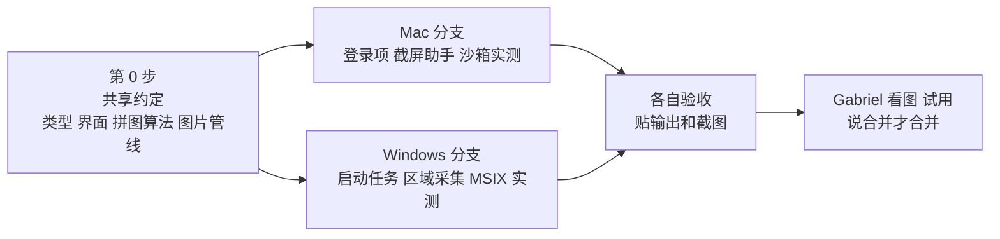
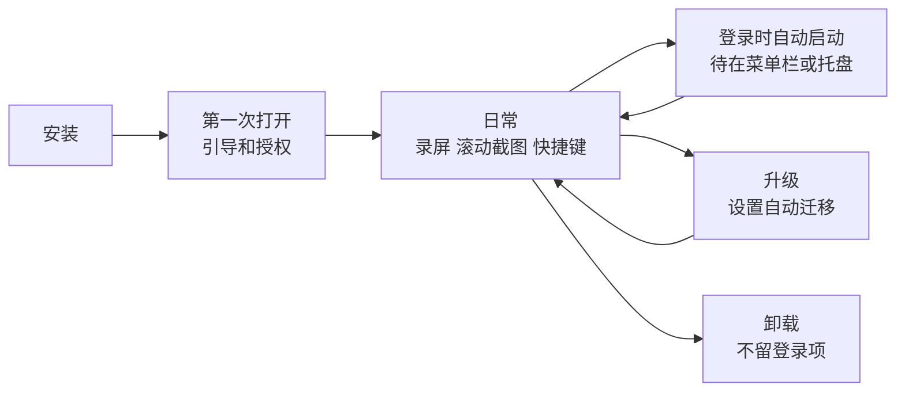
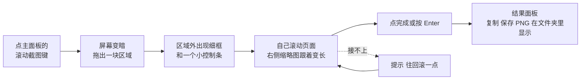
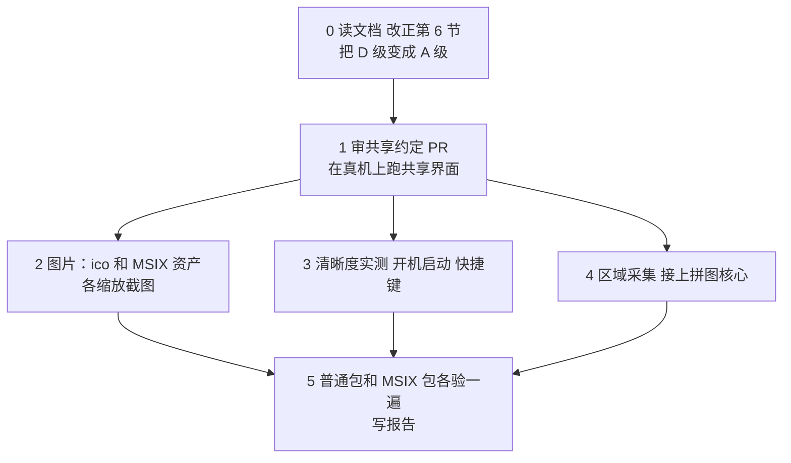

# 09 · 下一轮计划（Windows）：图片资产、4K、快捷键、开机启动、滚动截图

- 日期：2026-11-13。作者：Claude（Mac 负责人）起草，**给 Windows 负责人执行和修正**。状态：计划，等 Gabriel 点头再动手。
- 依据：Gabriel 2026-11-13 的七条要求。配套的 Mac 计划是 `08-下一轮计划-Mac-2026-11-13.md`；第 2–5 节两份完全相同。
- 证据级别：**A** 读了代码、包或官方原文；**D** 我的推断，待验证。**Windows 平台的做法我没有在 Windows 机器上试过，第 6 节全部是 D 级，Windows 负责人动手前先读微软文档原文并改正这份计划。**
- **2026-11-13 Windows 负责人已核对第 6 节**：改写为 A 级（微软原文或本机实测），D 级只剩明确标出的几处；对原计划的改动见 6.2，对共享约定的两条建议见 6.3。

## 1. 给 Windows 负责人的话

- 先读仓库根目录的 `CLAUDE.md`、`00-START-HERE.md`、`docs/reports/07-Windows-上架版重构-2026-11-12.md`，再读这份。
- 硬规矩和上一轮一样：只推 `win/*` 分支、只开草稿 PR、不合并、不强推；不加联网、遥测、更新检查；不改系统安全设置、不点 UAC；不改 `chrome-extension/`；“通过”要有输出或截图；命令 15 分钟没输出就当被弹框卡住。
- 共享部分（类型、界面、拼图算法、图片管线）由 Mac 负责人在 `shared/next-round-contract` 上写，你来审，并在真机上验。你做 Windows 的平台层。发现约定在 Windows 上行不通，在 PR 里提出来改约定，不要自己绕开。
- 昨晚合并后 Mac 上架版一点录制就闪退，原因是共享的窗口代码改到了后台线程（已在 main 上修，`b84c87e`）。动共享窗口代码后，请在 PR 里写明，让 Mac 这边重测。

## 2. 这一轮要做的六件事

| # | 要做的事 | 现在的状态（查于 2026-11-13，A · 读了代码和包） | 做完是什么样 |
|---|---|---|---|
| 1 | 图片资产统一 | 应用图标已是新的 3D 磁带机。托盘图标还是老的小圆点；Chrome 插件图标是老的；没有一处写清“每张图用在哪” | 所有图从一个文件夹、一个脚本生成；老图一张不剩；有一张清单 |
| 2 | 录制清晰度 | 设置里叫“最大宽度”，只有 1280 / 1920 / 2560，没有 4K | 主面板和设置里都能选 1080p / 4K，另有 720p、1440p、原始 |
| 3 | 全局快捷键 | **已经有**：设置 → 快捷键，能改“开始／停止”“暂停”两个。但入口深，冲突只写日志不提示 | 入口看得见；动作从 2 个加到 5 个；冲突当场提示；能恢复默认 |
| 4 | 开机启动 | 没有 | 设置 → 通用里一个开关；可选“启动后只待在菜单栏／托盘” |
| 5 | 滚动截图 | 没有 | 主面板一个按键；框一块区域，自己滚，自动拼成长图；复制或存 PNG |
| 6 | 找得到程序 | 打出来的包埋在 `src-tauri/target/…` 里 | 打包脚本最后打印位置并在文件管理器里选中它；有“安装到应用程序”的一步 |



## 3. 整个生命周期里，用户会碰到什么



| 阶段 | 这一轮要保证的 |
|---|---|
| 安装 | 用户知道程序在哪：Mac 在“应用程序”，Windows 在开始菜单。图标在访达、Dock、任务栏、开始菜单、系统设置里都是新图 |
| 第一次打开 | 引导页多一屏，告诉用户三个快捷键和“滚动截图”在哪；不新增任何授权（滚动截图用的还是录屏授权） |
| 日常 | 主面板上直接能选清晰度、能点滚动截图；每个按键的提示里带它的快捷键 |
| 自动启动 | 开关的状态以系统为准（用户在系统设置里关掉，我们的开关也跟着变）；自动启动时不弹主窗口 |
| 升级 | 老设置 `video.maxWidth` 原样沿用，不丢；新字段有默认值；设置版本号加一并写迁移测试 |
| 卸载 | 登录项随应用一起消失；不往系统里写卸载后清不掉的东西 |

不变的规矩：不加联网、遥测、更新检查；不放宽 CSP；录像、截图、二进制不进 git。

## 4. 每件事的设计

### 4.1 图片资产（最看重美观的一项）

**一个源头，一个脚本，一张清单。**

```
design/brand/                      ← 只放“源”，人会改的东西
  icon_blender.py                  ← 现有的建模脚本，从 scripts/icons/ 搬来
  icon-full-1024.png               ← 完整画：≥64 px 的图都从它来
  icon-small-512.png               ← 简化画：≤50 px 的图都从它来
  tray/                            ← 托盘字形的源（SVG）
  store/                           ← 商店截图、宣传图的源
  ASSETS.md                        ← 清单：每张成品图多大、从哪张源来、用在哪
scripts/make-icons.sh              ← 唯一的生成入口
src-tauri/icons/  src-tauri/msix/Assets/  src/assets/brand/   ← 全是生成物
```

| 用在哪 | 尺寸 | 规则 |
|---|---|---|
| macOS 应用图标 `.icns` | 16、32、128、256、512，各带 @2x，到 1024 | 16、32 用简化画，其余用完整画；面板占画布 86 % |
| Mac App Store | 1024，无透明 | 从完整画出 |
| Windows `.ico` | 16、20、24、32、40、48、64、256 | ≤48 用简化画 |
| Windows MSIX 磁贴和任务栏 | 44、71、150、310、宽 310×150、商店 50；缩放 100／125／150／200／400；任务栏另要“无底板”的 16、24、32、48、256 | 小于 50 px 的一律简化画 |
| 菜单栏／托盘 | Mac：18 pt 单色模板图 @1x @2x；Windows：16、20、24、32，亮暗两套 | **重画**：两个卷盘的剪影，录制中右上角加红点。现在的小圆点是老设计 |
| 应用内 | 引导页、关于页、空状态用的标志，SVG 或 2x PNG | 从同一个源出，不手工另画 |
| Chrome 插件 | 16、32、48、128 | 同一个源。**`chrome-extension/` 现在不许改，要 Gabriel 点头** |

**“老图一张不剩”怎么保证**：`make-icons.sh --check` 做两件事并进测试——（1）仓库里每张图片都必须出现在 `ASSETS.md` 里，多一张少一张都失败；（2）记下老图标的哈希，仓库里和打出来的包里再出现就失败。

**美观怎么验收**：不靠“我觉得好看”。每个尺寸都放到真实位置截图（Dock、访达、系统设置、任务栏、开始菜单、托盘亮色和暗色），拼成一张对照图 `tests/out/brand/contact-sheet.png` 给 Gabriel 看；16 px 和 32 px 下红色录制点必须看得见。Gabriel 说“不好看”就改源重出，脚本保证一次全换。

### 4.2 录制清晰度

- 名字从“最大宽度”改成“清晰度”，选项：**720p · 1080p（默认）· 1440p · 4K · 原始**。内部仍是 `video.maxWidth`（1280／1920／2560／3840／0），老设置不用迁移。
- 主面板加一个两档小拨杆 **1080p ／ 4K**（和现有拨杆同一套零件）；其余档位在设置里。选了别的档位时拨杆显示实际值。
- **不放大**：屏幕本身不到 4K 时，4K 一档变灰，旁边写“这块屏幕最多 3024 × 1964”这样的实数。
- **码率跟着走**：现在是按“每小时多少 MB”定码率。4K 的像素是 1080p 的 4 倍，同样的预算会糊。规则：切到更高清晰度时，如果预算低于该档的建议值，提示并一键调到建议值（1080p 400、1440p 700、4K 1500 MB／小时，数字先按像素比例估，实测后改）。主面板下方那行“每小时约多少 MB”实时更新。
- 4K 且 60 帧、又只有软件编码器时，提示“这台机器可能跟不上”，不拦。

### 4.3 全局快捷键

| 动作 | 默认（Mac ／ Windows） | 现状 |
|---|---|---|
| 开始／停止录制 | ⌘⇧R ／ Ctrl+Shift+R | 已有 |
| 暂停／继续 | ⌘⇧P ／ Ctrl+Shift+P | 已有 |
| 滚动截图 | ⌥⇧S ／ Alt+Shift+S | 新增 |
| 显示／隐藏主窗口 | 默认不设 | 新增 |
| 滚动截图时“完成” | Enter（只在截图进行中有效，不是全局） | 新增 |

- 设置页“快捷键”一栏：每行一个录入框（现有 `ShortcutField`），加“清除”和“恢复默认”。
- **冲突当场说**：注册失败时，这一行下面显示“这个组合已被别的程序占用”，不保存。现在只写日志，用户不知道。
- 两个动作不许设成同一个组合。
- 看得见：主面板每个按键的悬停提示、托盘菜单的每一项后面都带快捷键。
- 默认值避开系统自带的（Mac 的 ⌘⇧3／4／5，Windows 的 Win+Shift+S）。

### 4.4 开机启动

- 设置 → 通用：**“登录后自动启动”** 开关；下面一个子选项 **“自动启动时只待在菜单栏／托盘”**（默认开）。
- 开关不存进我们的设置文件，**每次从系统读**。用户在系统里关了，界面如实显示；系统说“需要用户批准”时，显示一句话和“打开系统设置”的按钮。
- 能力开关 `autostart`：平台做不了就不显示这一行，界面不写平台判断。
- 自动启动时带一个启动参数，程序据此不弹主窗口。

### 4.5 滚动截图

**用户怎么用（两个平台一样）：**



- **只做手动滚动**。不替用户滚：那需要往别的程序注入鼠标事件，Mac 上要“辅助功能”授权，沙箱里的应用基本拿不到 `[D · 推断，未实测]`。手动滚动只需要已有的录屏授权，滚轮、拖滚动条、翻页键都行。
- 控制条：缩略图（最新一帧描边）、已拼高度（像素）、完成、取消。控制条和细框不进截图。
- 往下滚、往上滚都能接；横向不做。区域大小固定，改区域等于重来。
- 上限：长图高度到 30,000 像素或内存到 300 MB 时自动完成并说明原因。
- 保存：PNG，放在录像文件夹下的 `Screenshots/`（不新增文件夹授权），文件名沿用现有模板；同时放进剪贴板。Retina 屏按物理像素存，并写入 144 dpi。
- 滚动截图进行中不能开始录屏，反过来也一样；按键变灰并说明。

**拼图算法（放在 `recorder-core`，纯 Rust，不碰系统，任何系统上都能测）：**

参考 jietuba 的 `longstitch`（MIT 许可，`[A · 读了它的 LICENSE 和源码，2026-11-13]`）。它只支持 Windows，外壳是 C++／Qt，但拼图核心是纯 Rust。我们按它的思路重写，在 `docs/LICENSES.md` 里写明来源和许可。

1. 每帧每一行算两个哈希：精确的（逐字节滚动哈希）和粗略的（这一行的平均颜色，量化到 8 级）。右边 10 % 不算，避开滚动条。
2. 和上一帧同一位置哈希相同的顶部、底部若干行，当作固定的页眉页脚，不参与匹配。
3. 在已拼结果的末尾附近（往回两帧高、往前一帧高）找“最长的连续相同行”，取前 32 个候选。
4. 候选里要有至少 8 行是“在两边都只出现一次”的，才算数（防止空白和重复列表项误配）。精确哈希不行再用粗略哈希。
5. 用亮度剖面复核：抽样最多 256 行，75 % 以上差值在 2 以内才接受。
6. 接缝放在两边确实一致的地方；接不上就不动结果，提示用户往回滚。

**这套算法已知的短板**（来自它的代码注释）：区域里有视频或动画会一直触发；一次滚过一整屏会接不上；只认顶部和底部的固定条，侧边栏和悬浮按钮靠复核兜底；鼠标悬停高亮、闪烁的光标会让精确哈希失配。

**测试**：单元测试用一张合成的长图切成帧（随机步长、带固定页眉页脚、带滚动条、带少量噪点），拼回来必须和原图逐像素相等。真机测 5 个场景：浏览器长网页、文件管理器长列表、代码编辑器、带固定标题栏的聊天窗口、PDF。每个场景留一张成品图和一句结论。

### 4.6 找得到程序

- 两个打包脚本结束时打印成品的位置，并在访达／资源管理器里选中它。
- 各加一个“装到本机”的步骤（见下面平台章节），Gabriel 以后从“应用程序”或开始菜单打开，不用再找 `target` 目录。

## 5. 共享约定（两边都按这个写，谁也不单方面改）

| 项 | 约定 |
|---|---|
| 设置 | `video.maxWidth` 增加 3840 和 0（原始）；`shortcuts` 增加 `scrollCapture`、`showWindow`；新增 `startHiddenOnLogin: bool`。设置版本号加一，`types.rs` 和 `types.ts` 同一个提交里改 |
| 能力开关 | `scrollCapture: bool`、`autostart: bool`、`maxCaptureWidth: number`（当前屏幕的物理宽度）。界面只看开关 |
| 命令 | `autostart_status()` → `on / off / needsApproval`；`autostart_set(bool)`；`scroll_capture_start(rect)`；`scroll_capture_finish()`；`scroll_capture_cancel()`；事件 `scroll://progress {height, thumbnail}`、`scroll://warning {kind}` |
| 采集帧 | 平台层交给核心的是固定大小的 BGRA 物理像素帧；内容没变就不交 |
| 文字 | 全部走 i18n，中英文都有 |
| 分支 | 共享部分 `shared/next-round-contract`（Mac 负责人写，Windows 负责人审）；平台部分 `mac/*`、`win/*`。只开草稿 PR，Gabriel 说合并才合并 |

**分工**：共享的类型、界面、拼图算法、图片管线由 Mac 负责人做（都能在 Mac 上用假数据测）；Windows 负责人做 Windows 的平台层，并在真机上验共享界面。这样两边不会同时改同一个文件。

## 6. Windows 这边具体怎么做（Windows 负责人 2026-11-13 核对后改写）

本节原来全是 D 级推断。现在每一条都对过微软原文，或在这台机器上实测过（Windows 11，Intel 核显，一块 3840×2160 屏幕）。微软原文存在 `tests/out/next-round/sources/`，实测输出存在 `tests/out/next-round/enc/`，两个目录都不进 git。引文后面的日期是该页的“最后更新”日期。

### 6.1 逐项结论

| 项 | 做法（改正后） | 依据 |
|---|---|---|
| 图片 · `.ico` | 至少 16、24、32、48、256，现在的 `.ico` 已含这些（另有 64）。20、40 可以加，不是必须 | **A** 微软图标构造页：“at the bare minimum: 16x16, 24x24, 32x32, 48x48, and 256x256”（2026-07-27） |
| 图片 · MSIX | 清单**必须**有的只有 `Square150x150Logo` 和 `Square44x44Logo`。商店**必须**有中磁贴 100 % 和 `StoreLogo`。Windows 11 真正显示的是 `Square44x44Logo` 的 targetsize 图：16、20、24、30、32、36、40、48、60、64、72、80、96、256，**每个尺寸三份**（普通、`_altform-unplated` 深色、`_altform-lightunplated` 浅色）。缺了会被套上底板、缩小显示。现在的包只有 16／24／32／48／256 和深色无底板，**缺 9 个尺寸和全部浅色版**。宽磁贴、71、310 在 Windows 11 不显示，可以不出 | **A** 同一页：“Separate files for all three theme variations … are required, even if the icon is the same”；“Windows 11 does not use the tile assets, but currently at minimum the Medium tile assets at 100% are required to publish to the Microsoft Store”。清单架构把这两项标为必填（2026-06-17）。现状 **A** 读了 `layout/Assets/` |
| 图片 · 托盘 | 16、20、24、32（100 %～200 % 缩放），再加 40、48、64 覆盖到 400 %。亮暗两套：微软有文档的只是“应用的颜色模式”（`UISettings`）和注册表 `SystemUsesLightTheme`（“Windows 的颜色模式”）。**没有一个接口直接告诉你任务栏是亮是暗**，按 `SystemUsesLightTheme` 选是推断。另外 Tauri 的“模板图”只对 Mac 有效，Windows 要自己换图 | **A** 图标构造页的托盘尺寸表；设置参考页（2024-04-03）。任务栏跟随哪一项：**D** |
| 清晰度 · 4K 能不能录 | **能**。真屏 3840×2160 采 10 秒：`hevc_mf` 硬件 30 帧掉 2 帧、60 帧掉 3 帧，`h264_mf` 硬件 30 帧掉 1 帧，三项都跟得上实时 | **A** 实测 `enc/real-screen-4k.txt`（录像已删，只留数字） |
| 清晰度 · 合成 4K 画面 | 三个编码器在 4K 30 帧和 60 帧下都快于实时（1.85～4.09 倍）。但**软件 H.264 码率失控**：目标 6 Mbps，30 帧实际 8.9，60 帧 13.2；硬件 H.264 在 60 帧也到了 8.5。所以 4.2 的“码率跟着走”在 Windows 上要加一条：软件编码时预算只能当上限的参考，实际可能超出约 50 %～120 % | **A** 实测 `enc/synthetic.txt` |
| 清晰度 · 编码器上限 | 微软编码器页**没写最大分辨率**，只说等级让编码器自己选，并且装了认证的硬件编码器时一般用硬件的。所以上限只能实测，不能查表。这台机器上 HEVC 4K60 自动选了 level 5.1，H.264 选了 5.2 | **A** H.264／HEVC 编码器页（2021-08-19）；实测同上 |
| 快捷键 · 冲突检测 | `RegisterHotKey` 只能发现“别的程序也用 `RegisterHotKey` 注册了同一组合”。**它发现不了别的程序窗口里的快捷键**，我们注册后会把它们抢走。现有默认值正好撞上两个常用的：`Ctrl+Shift+R` 是 Edge 的“忽略缓存重新加载”，`Ctrl+Shift+P` 是 Edge 的“用系统对话框打印”和 VS Code 的命令面板。4.3 的“冲突当场说”只能覆盖一半，**建议 Gabriel 重新定 Windows 默认值** | **A** RegisterHotKey 页（2024-06-12）、Edge 快捷键页、VS Code 快捷键文档 |
| 快捷键 · 系统保留 | 带 Win 键的组合全部保留给系统；F12 保留给调试器。`Win+Shift+S` 是截图，`Win+Alt+R` 是 Game Bar 录屏。`Ctrl+Shift` 是切换键盘布局（Gabriel 用中文输入法时要注意）。计划里的 `Alt+Shift+S` 不在系统快捷键表里 | **A** RegisterHotKey 页；Windows 快捷键页；Game Bar 说明页 |
| 快捷键 · MSIX 里 | **能注册**：已注册的商店版在有包身份时占住了 Ctrl+Shift+R 和 Ctrl+Shift+P，别的程序再注册同一组合得到错误 1409（“热键已被注册”）。按下后是否真的触发录制，还没按过 | **A** 实测 `hotkey-probe.txt`；触发：**未验证** |
| 开机启动 · MSIX | **只能用启动任务**，不能写注册表 `Run`：打包应用写 HKCU 会被复制到应用自己的私有位置，系统看不到。清单加 `uap5:StartupTask`（`Executable="flowgt-recorder.exe"`、`EntryPoint="Windows.FullTrustApplication"`、`Enabled="false"`）。打包的桌面应用调 `RequestEnableAsync` **不弹确认框**；用户至少要先打开过一次应用 | **A** MSIX 幕后页：“All writes under HKCU are copied on write to a private per-user, per-app location”；StartupTask 类页 |
| 开机启动 · MSIX 状态 | `Enabled`／`EnabledByPolicy` → on；`Disabled` → off；`DisabledByUser` → `needsApproval`（用户在任务管理器或设置里关的，**程序不能再打开**，只能告诉用户去“设置 → 应用 → 启动”）；`DisabledByPolicy` → 管理员禁止，**约定里没有对应值**，见 6.3 | **A** StartupTaskState 页：“It can only be re-enabled by the user”；RequestEnableAsync 页 |
| 开机启动 · 不弹主窗口 | MSIX 启动任务**不能带启动参数**（清单里没有这一项）。改为程序启动时问“我是不是被启动任务拉起来的”：`AppInstance.GetActivatedEventArgs()` 的种类是 `StartupTask`。注意这个调用**只在第一次调用时有结果**，要在启动最早的地方调一次并记住 | **A** ActivationKind、AppInstance 页。参数：**无原文**，清单语法里没有这个属性 |
| 开机启动 · 普通安装包 | 写 HKCU `Run`，命令行带 `--autostart`（不超过 260 字符），不需要管理员。**已知缺口**：用户在任务管理器里禁用后，微软没有公开的接口能读到这个状态（社区说的 `StartupApproved` 键没有文档，按规矩不用），所以开关会显示“开”但实际不启动。界面要写一句“如在任务管理器里禁用过，请到那里重新启用” | **A** Run／RunOnce 页（2026-02-21）；禁用状态：**无原文** |
| 滚动截图 · 采集接口 | **用现有 ffmpeg 的桌面复制（`ddagrab`）**，不新写图形采集代码。理由：（1）录屏已经在用，MSIX 无身份运行已验证；（2）它能直接只取一块矩形（`video_size`、`offset_x`、`offset_y`），按物理像素，实测 800×600 区域 10 帧／秒稳定；（3）图形采集接口（Windows.Graphics.Capture）**没有裁剪**，要自己裁，而且系统会在被采集的东西外画**黄框**，去掉黄框要弹框征得用户同意并声明能力，多一次授权，违背 4.5 的“不新增授权” | **A** 实测 `enc/ddagrab-region.txt`、`enc/ddagrab-options.txt`；屏幕采集页（2026-08-23）、IsBorderRequired 页 |
| 滚动截图 · “没变就不交” | ffmpeg 的 `dup_frames=0` 在实测里没有减少帧数（40 帧对 40 帧）。可能区域里本来就有在变的东西，结论不可靠。**建议把“去重”放进 `recorder-core`**：平台照常 10 帧／秒交帧，核心用整帧哈希跳过重复帧，两个平台一样，好测 | **A** 实测；改约定的建议见 6.3 |
| 滚动截图 · 控制条和细框 | 用现有的 `set_content_protected`：Tauri 的窗口库在 Windows 上调 `SetWindowDisplayAffinity(WDA_EXCLUDEFROMCAPTURE)`，Windows 10 2004 起有效，只能用在自己的顶层窗口。微软原文**没写**它对桌面复制和图形采集分别是否生效；上一轮录屏实测悬浮条不进视频，这一条按实测算 | **A** 读了 `tao-0.37.2` 源码；SetWindowDisplayAffinity 页（2024-02-22）；覆盖哪种采集：**原文无**，实测证据在 PR #6 |
| 滚动截图 · 多屏和缩放 | 桌面复制是**按块屏**取的（一块屏一个复制接口），所以**选区不许跨屏**，选区层在哪块屏就只在那块屏上画。界面坐标是逻辑像素，交给 ffmpeg 前乘以那块屏的缩放比例。微软原文没讲不同缩放下的行为，要实测 | **A** DuplicateOutput 页（2021-10-13）；不同缩放：**未验证** |
| 滚动截图 · 数据量 | BGRA 一帧 = 宽×高×4 字节。800×600 区域 10 帧／秒是 19 MB／秒，没问题；整块 4K 屏是 330 MB／秒，太大。建议区域超过 1600 万像素／秒时降到 5 帧／秒 | 计算 |
| 滚动截图 · 界面 | 透明窗口**在有包身份时还没验证过**。上一轮只在“包里的程序直接启动、没有包身份”的情况下验过，Gabriel 注册包以后也还没走查 | **A** 上一轮报告 07；`视频\FlowGT Recorder` 里注册之后没有新录像 |
| 保存 | PNG 写到录像文件夹下的 `Screenshots\`。`视频` 文件夹在 MSIX 下**不**重定向（只有 AppData 和 HKCU 重定向），沿用上一轮结论，但同样是有身份时**未实测** | **A** MSIX 幕后页；实测：**未验证** |
| 找得到程序 · 普通安装包 | Tauri 的 NSIS 默认“当前用户”安装，不需要管理员，装完开始菜单里有 | **A** 读了 `tauri-utils-2.10.2` 的默认值；装完的样子：**未验证** |
| 找得到程序 · MSIX | 计划原文“MSIX 没法在不改系统设置的情况下装”仍然对。但 Gabriel 2026-11-12 **已经打开开发人员模式**，这台机器上可以不用管理员：`Add-AppxPackage -Register <layout>\AppxManifest.xml`。坑：注册后程序**从 layout 文件夹原地运行**，重新打包会改写正在用的文件。建议打包脚本加一步“复制到单独的安装文件夹再注册” | **A** 2026-11-12 实测（`store-win/20-installed-identity.txt`） |
| 自动滚动 | 同意这一轮不做 | — |

### 6.2 原计划里要改的地方

1. **4.1 MSIX 那一行**：补上 20、30、36、40、60、64、72、80、96 和全部 `_altform-lightunplated`。宽磁贴、71、310 删掉（Windows 11 不用）。中磁贴 100 % 和 `StoreLogo` 标“商店必需”。
2. **4.3 默认快捷键**：Windows 的 `Ctrl+Shift+R`、`Ctrl+Shift+P` 会抢走 Edge 和 VS Code 的快捷键，而且我们检测不到。**Gabriel 2026-11-13 已定：Windows 默认改为 Alt+Shift+R 开始／停止、Alt+Shift+P 暂停／继续、Alt+Shift+S 滚动截图。**选它的理由：暂停键和 Loom 相同；三个键同一套修饰键；Mac 的 ⌥ 就是 Alt，两边可以用同样的字母（Mac 跟不跟，由 Mac 负责人和 Gabriel 定）。本机实测这三个组合都没有被别的程序占用（，17 个候选里只有旧默认值被占，占用者是已注册的 FlowGT 商店版本身，这也证明商店版在有包身份时能注册全局热键）。已知代价：Alt+Shift+P 会抢走资源管理器的“显示／隐藏详细信息窗格” **A**。未验证：中文输入法下 Alt+Shift 是否同时切换输入语言 **D**，要 Gabriel 亲手按一次。改法属于共享约定：默认值在  的  和 ，两处一起改；老用户的设置如果仍是旧默认值就迁移到新值，自己改过的不动；设置版本号加一并写迁移测试。“冲突当场说”的文案改成“这个组合已被别的程序用全局方式占用”，并在说明里提醒“程序窗口里自己的快捷键检测不到”。
3. **4.4 开机启动**：“自动启动时带一个启动参数”在 MSIX 上做不到，改为“判断自己是不是被启动任务拉起的”。普通安装包里任务管理器的“禁用”读不到，要在界面上说明。
4. **4.2 码率**：Windows 软件 H.264 在 4K 下码率超标约 50 %～120 %，提示文案和预算估算要考虑这一点。
5. **第 8 节验收的开机启动**：MSIX 部分可以不用重新登录也能验一半：调 `RequestEnableAsync` 后看任务管理器“启动应用”里有没有出现。

### 6.3 要改共享约定的两条（在 PR 里提，不自己绕开）

- **`autostart_status()` 加第四个值 `blocked`**，对应 Windows 的 `DisabledByPolicy`（管理员或组策略禁止）。用户自己改不了，界面应该显示为灰色加一句说明，而不是 `needsApproval` 的“去设置里打开”。
- **“内容没变就不交”从平台层挪到核心**：平台照常交帧，核心比较哈希。理由见 6.1；这样 Mac 也少写一份代码。

## 7. 顺序



## 8. 验收（“通过”＝跑过并贴了输出或截图）

| 项 | 怎么验 |
|---|---|
| 自动检查 | 类型检查、前端测试、Rust 测试、clippy；`make-icons.sh --check` |
| 图片 | 三种缩放下的对照图；包里搜不到老图标的哈希 |
| 清晰度 | 每一档录 10 秒，用 ffprobe 读宽高和码率；机器没有 4K 屏就写“未验证”并跑合成画面的 4K 编码 |
| 快捷键 | 主窗口隐藏时 5 个动作都响应；占用冲突有提示 |
| 开机启动 | 打开开关 → 任务管理器“启动应用”里出现 → 重新登录后程序在托盘、没弹主窗口 → 关掉后消失。要重新登录的那一步如果做不了，写“未验证” |
| 滚动截图 | 5 个真实场景（Edge 长网页、资源管理器长列表、VS Code、带固定标题栏的聊天窗口、PDF）各一张成品图 |
| 不坏 Mac | 共享文件的改动在 PR 里逐个列出 |

报告写 `docs/reports/10-…`，格式照 07。

## 9. 这份计划里最没把握的三条

（2026-11-13 Windows 负责人：第 1、3 条已按微软原文核对，见 6.1；第 2 条选了桌面复制，理由见 6.1。剩下的不确定：有包身份时的透明窗口、热键和保存位置，要等装好的包走查。）

1. **MSIX 下的开机启动。** 清单怎么写、被用户禁用后的行为，都是我凭记忆写的。验证：读微软 StartupTask 文档原文，在第 0 步改正。
2. **区域采集接口的选择。** 我不知道哪一套在排除自身窗口、多显示器、HDR 下更稳。验证：Windows 负责人各试一遍，留数据。
3. **MSIX 的图片清单。** 尺寸和文件名我没有核对。验证：打包后跑上一轮用过的清单校验，再在三种缩放下截图。
