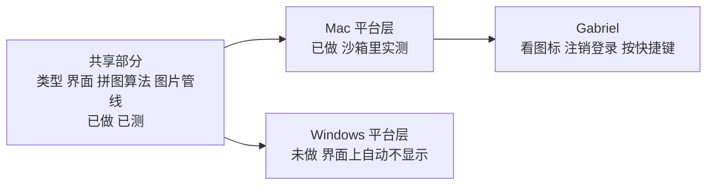

# 10 · 下一轮在 Mac 上做完的：滚动截图、4K、开机启动、快捷键、图片资产

- 日期：2026-11-13。作者：Claude（Mac 负责人）。分支：`mac/next-round`，草稿 PR。计划见报告 08（Mac）和 09（Windows）。
- 证据在 `tests/out/next-round/` 和 `tests/out/brand/`（已被 git 忽略）。级别：**A** 本机命令输出或截图；**D** 我的推断。核实日期都是 2026-11-13。
- 全部在 **Mac 上架版（沙箱）** 里测，用的是本机测试签名，装在 `/Applications`。

## 1. 结论

六件事在 Mac 上都做了，五件在沙箱里实测通过，一件（图标）只验了一半。Windows 的平台层没做，共享部分已经留好接口。

## 2. 逐项结果

| 事 | 结果 | 证据 |
|---|---|---|
| 滚动截图 | **通过**。框一块区域，测试窗口自己滚 300 行，拼出 1156 × 10768 像素的长图，144 dpi；抽看中段行号 159–193 连续无错位 | A · `02-scroll-textwindow.png`、`crop-5200.png` |
| 滚动截图·控制条 | **通过**（修过一次）。第一版控制条收不到进度，原因是新窗口没被允许监听事件；加了 `capabilities/scroll.json` 后缩略图、高度、“接不上”的提示都出来了 | A · 截图 |
| 滚动截图·结果 | **通过**。完成后主窗口回来，卡片上有预览、尺寸、路径、“已放进剪贴板”；文件在 `~/Movies/FlowGT Recorder/Screenshots/` | A · 截图、`ls` |
| 清晰度 | **通过**。主面板 1080p／4K 开关，设置里五档；选 4K 后录出 3024 × 1964 HEVC（这块屏幕的全部像素），25.6 秒 | A · `04-recording-4k-step.txt` |
| 真正的 3840 × 2160 | **未验证** | 这台 MacBook 内屏只有 3024 像素宽。只有单元测试覆盖了 3840 的换算 |
| 开机启动·开关 | **通过**。打开后系统登录项里出现 `FlowGT Recorder`（sandboxed，enabled）；关掉后变 disabled | A · `03-login-item-on.txt`、`03-login-item-off.txt` |
| 开机启动·真的随登录启动、且不弹窗口 | **未验证** | 要注销再登录，我做不了。测完我把开关关回去了 |
| 快捷键·注册 | **通过**。沙箱里四个快捷键的状态都是“已注册”，设置页没有报占用 | A · 设置页截图 |
| 快捷键·真的按下去有反应 | **未验证** | 后台控制发不了全局按键 |
| 快捷键·冲突提示 | 只有界面测试 | 没有在真机上造一个冲突 |
| 图片·管线 | **通过**。源都在 `design/brand/`；`make-icons.sh` 生成 42 张并写清单；`--check` 对仓库和打出来的包都报“没有老图” | A · `checks.txt`、`01-build-mas.txt` |
| 图片·Dock | **通过**。Dock 里是新的 3D 磁带机，没有被系统套上额外底板 | A · `tests/out/brand/dock-icon.png` |
| 图片·菜单栏新图标 | **未验证** | 你的菜单栏有折叠工具，图标被收起来了，截不到。画出来的样子见 `tests/out/next-round/tray-big.png` |
| 图片·系统设置里的老图标 | **原因找到了，没处理** | 见第 4 节 |
| 找得到程序 | **通过**。`bash scripts/install-mac.sh` 装到 `/Applications/FlowGT Recorder.app`；两个打包脚本结束时在访达里选中成品 | A · 命令输出 |

自动检查（`tests/out/next-round/checks.txt`）：类型检查 0 错；前端测试 159 通过（新增 12 个）；Rust 测试 47 ＋ 143 通过，普通版和上架版各一遍（新增拼图 14 个、设置 3 个、滚动截图 3 个、开机启动 2 个）；clippy 两种构建都干净；Swift 助手测试 17 通过；图片检查通过。

## 3. 做法和计划不一样的地方

| 计划里写的 | 实际 | 原因 |
|---|---|---|
| 选区是半透明压暗的窗口 | 先给屏幕拍一张静止画面，在不透明窗口里显示并压暗 | 上架版不能有透明网页窗口。副作用：**需要 macOS 14**，13 上这个按键不出现 |
| 共享部分和 Mac 部分分两个分支 | 一个分支 `mac/next-round` | 平台代码都在编译开关后面，分开只会多一次合并 |
| 码率不够时“提示并一键调” | 主面板上直接调高并弹一句话；设置页是提示加按钮 | 主面板上没地方放按钮 |
| 滚动截图的“完成”绑 Enter | 再按一次滚动截图的快捷键也是完成 | 滚动时焦点在别的程序上，控制条收不到 Enter |
| 引导页加一屏 | 没做 | 时间用在了实测上 |
| 清晰度建议值 1080p 400／1440p 700／4K 1500 | 按像素数算：3840 × 2160 是 1150，3024 × 1964 是 900 | 细节不随像素数等比增长。**这个公式没有用画质实测校准过** `[D]` |

## 4. 系统设置里的老图标：原因

桌面上 11 月 5 日的旧包 `~/Desktop/FlowGT Recorder.app` 和新版是同一个应用标识，系统两个都认。今天实测：执行 `open -a "FlowGT Recorder"`，**系统打开的是桌面上那个旧包**，不是 `/Applications` 里的新版 `[A · 进程列表]`。旧包的图标指纹在“已退役图片”名单里 `[A]`。所以只要旧包还在，系统设置、聚焦搜索都可能拿到它。

处理要你点头，因为那是你桌面上的文件：把它移到废纸篓，然后在“系统设置 → 隐私与安全性 → 录屏与系统录音”里删掉旧条目、给新版重新授权。

## 5. 留给你的事

1. **看图标**：Dock、访达里的应用图标；把菜单栏的折叠展开，看新的托盘图标（两个卷盘加磁带）。不好看就告诉我改哪里。
2. **桌面旧包**：说一声能不能移到废纸篓（见第 4 节）。
3. **按快捷键**：⌘⇧R 开始／停止，⌘⇧P 暂停，⌥⇧S 滚动截图。
4. **开机启动**：设置 → 通用最下面，打开“登录后自动启动”，注销再登录，看程序是不是在菜单栏、没弹窗口。
5. **自己滚一次**：在浏览器长网页上用一次滚动截图。我只测了匀速自动滚动的文本窗口，没测带回弹的真实网页。
6. **Chrome 插件图标**要不要换（`chrome-extension/` 现在不许我改）。
7. **删测试文件**：`~/Movies/FlowGT Recorder/2026-11-13 1021 录像.mp4`，以及 `Screenshots/` 里 10:12、10:19 两张。

## 6. 给 Windows 负责人

共享部分已经在这条分支上，Windows 上现在的表现是：滚动截图的按键和开机启动的开关**不显示**（两个能力开关是关的），其余照常。要接的地方：

| 文件 | 要做的 |
|---|---|
| `src-tauri/src/scroll.rs` 的 `platform` 模块（非 macOS 那份） | 五个函数：`supported`、`display`、`still`（整屏静止画面，JPEG）、`frames`（一个子进程，标准输出按 `FGTF` ＋ 宽 ＋ 高 ＋ BGRA 行 的格式吐帧，画面没变就不吐）、`copy_png` |
| `src-tauri/src/autostart.rs` 的 `platform` 模块 | 五个函数；普通安装包用当前用户启动项，MSIX 用启动任务；被用户禁用映射成 `NeedsApproval` |
| `src-tauri/src/windows.rs` | 细框窗口在 Windows 上走透明网页（`#/scroll-frame` 已有）；自动启动时的启动参数 |
| `src-tauri/src/tray.rs` | 托盘图标换成 `tray-dark-*.png`／`tray-light-*.png`（已生成，没接） |
| `scripts/build-store-win.ps1` | 图标源搬到了 `design/brand/`，我改了两行路径，**没在 Windows 上跑过** |

动了共享的窗口代码请在 PR 里写明，Mac 这边要重测。

## 7. 最没把握的三条

1. **滚动截图在真实网页上的成功率。** 测试目标是我自己写的匀速滚动窗口，条件最理想。带回弹、懒加载、固定标题栏的网页只有单元测试里的合成数据。验证：第 5 节第 5 条。
2. **开机启动时“不弹窗口”。** 靠读启动时的系统事件判断是不是登录启动，这段代码从没在真实登录里跑过；判断失败的后果只是窗口照常弹出。验证：第 5 节第 4 条。
3. **清晰度对应的码率建议值。** 是公式算的，没有看过 900 MB／小时的 3024 像素录像到底清不清楚。验证：录一段有小字的内容，放大看。
